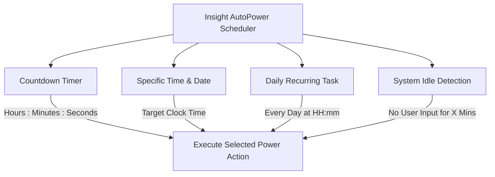

  

<h1 align="center">Insight AutoPower</h1>

  <strong>Next-Generation Windows Power Automation & Smart Scheduler</strong> 
  <em>أداة متطورة وحديثة لإدارة طاقة ويندوز والجدولة الذكية لإيقاف وتشغيل النظام</em>

  
  
  
  
  

  <a href="#key-features">Key Features</a> •
  <a href="#supported-actions">Power Actions</a> •
  <a href="#scheduler-modes">Scheduler Modes</a> •
  <a href="#screenshots">Screenshots</a> •
  <a href="#installation--download">Installation</a> •
    <a href="#arabic-documentation">الوصف بالعربية</a>

---

## ⚡ Overview

**Insight AutoPower** is a Windows desktop utility for scheduling power-management actions and managing system awake state. Built natively on **.NET 10.0 (Long Term Support)** and **WPF**, it combines several scheduling modes with a dark interface, circular countdown display, system-tray support, and configurable execution safeguards.

Whether you need to shut down your PC after a multi-hour render, sleep after nightly downloads, schedule recurring daily shutdowns, or keep your computer awake during crucial tasks, **Insight AutoPower** brings these controls together in a compact desktop interface.

---

## 📸 Screenshots

  
   
  <em>Cyber-Dark HUD Dashboard featuring the Circular Radial Countdown, Power Actions Selector, and Mode Configuration.</em>

---

## ✨ Key Features

- **🎨 Futuristic Cyber-Dark Interface**: Custom XAML UI inspired by telemetry cockpits, featuring high-contrast typography, neon status accents, and smooth feedback.
- **⏱️ Dynamic Radial Countdown**: Real-time circular progress gauge visually tracking the remaining time until scheduled task execution.
- **🛡️ Warning & Cancel Protection**: Configurable pre-action notifications and cancellation controls. Verify the warning duration and behavior in the release build.
- **☕ Keep System Awake ("Don't Sleep")**: Dedicated quick-toggle preventing sleep mode and display power-offs during active downloads or rendering jobs.
- **📥 System Tray Background Mode**: Minimizes cleanly to the Windows notification area with rapid right-click context menu controls.
- **⚡ 8 Comprehensive Power Actions**: Covers standard and advanced power routines including hybrid fast-boot bypass.
- **📅 4 Versatile Scheduling Engines**: Supports countdown timers, specific calendar dates/times, daily repeating routines, and idle detection.
- **📜 Task History**: Provides a history view for scheduled actions and execution results.
- **🔇 Silent Mode & Audio Toggles**: Full control over notification sounds, toast popups, and force-termination flags.
- **🌍 Native Bilingual Support**: Complete Arabic and English localized user interface.

---

## 🔌 Supported Power Actions

| Action | Icon | Technical Execution & Description |
| :--- | :---: | :--- |
| **Shutdown** | ⏻ | Requests Windows to shut down; save open work before the scheduled time. |
| **Full Shutdown** | ⚡ | Requests a non-hybrid shutdown. If the implementation uses `shutdown.exe /s /f /t 0`, `/f` forces applications to close and can cause loss of unsaved work. |
| **Restart** | 🔄 | Requests a Windows restart; save your work before execution. |
| **Hibernate** | ❄️ | Saves memory to `hiberfil.sys` and completely cuts power; resumes your exact session upon boot. |
| **Sleep** | 🌙 | Low-power standby state for immediate instant wakeup. |
| **Log Off** | 🚪 | Signs out the active Windows user session. |
| **Lock Screen** | 🔒 | Instantly locks the Windows workstation (`LockWorkStation`) to protect privacy. |
| **Don't Sleep** | ☕ | Uses Windows power requests to prevent automatic idle sleep while the setting is active (implementation details should be confirmed from source). |

---

## ⏰ Scheduler Modes

1. **Countdown Mode**: Set an exact duration (Hours:Minutes:Seconds) with the spinner controls or presets.
2. **Specific Time**: Schedule a one-off action at a selected clock time.
3. **Daily Task**: Automatically triggers the configured power routine at the same time every day.
4. **Idle Mode**: Monitors keyboard and mouse inactivity; triggers automatically when user absence exceeds the designated threshold.

---

## 🚀 Installation & Download

The Windows release files will be available from the [GitHub Releases page](https://github.com/alarifi/InsightAutoPower/releases) once the first release is published.

**Available distribution formats depend on the actual release assets:**

- **Installer (Inno Setup):** Use the installer asset only after it has been built and tested. Do not assume the installer is digitally signed; verify its Authenticode signature separately.
- **Portable ZIP:** Extract the complete archive, keeping its application files and dependencies together, and start the executable. If the build is *framework-dependent*, the matching **.NET 10 Desktop Runtime** must be installed. If it is *self-contained*, the .NET runtime is included in the package.

### Requirements

- Windows 10 or Windows 11, 64-bit (verify on each supported Windows version before publishing).
- Administrator approval might be needed for system-level operations in some configurations.
- Back up open documents and save work before scheduling shutdown, restart, or logoff actions.

> **Safety:** Enabling *Force close apps*, or any action that uses `shutdown.exe /f`, can terminate applications without prompting to save and may cause loss of unsaved data. Test a non-destructive action first.

---

## 💻 Tech Stack & Architecture

- **Documented target:** .NET 10 (`net10.0-windows` expected; confirm against the published project build)
- **Language:** C# (the exact language version depends on the project settings; .NET 10 defaults to C# 14 if not explicitly overridden)
- **UI:** Windows Presentation Foundation (WPF)
- **Integration:** Windows notification area, idle activity detection, and Windows power-management APIs
- **Packaging:** Inno Setup installer and/or portable archive, subject to actual verified build outputs

**Source availability:** The public GitHub repository is intended for documentation and binary releases; the C# source code is not published here.

---

 

## 🇸🇦 الوصف ودليل الاستخدام باللغة العربية

### نبذة عن البرنامج
برنامج **Insight AutoPower** هو أداة مكتبية احترافية ومتقدمة لنظام التشغيل ويندوز (Windows 10 / 11)، صُممت خصيصاً لإدارة وجدولة طاقة الكمبيوتر بدقة متناهية وسهولة مطلقة. تم بناء البرنامج بأحدث تقنيات مايكروسوفت **.NET 10.0 (LTS)** مع واجهة مستخدم رسومية حديثة بالكامل ذات طابع رقمي جذاب (Cyber-Dark UI) تمنح المستخدم تجربة بصرية وعملية استثنائية.

---

### أبرز المميزات
- **8 خيارات متكاملة للتحكم بالطاقة**:
  1. **إيقاف التشغيل (Shutdown)**: طلب إيقاف تشغيل ويندوز، ويجب حفظ العمل المفتوح مسبقًا.
  2. **إيقاف التشغيل بالكامل (Full Shutdown)**: تنفيذ إيقاف غير هجين؛ وقد يؤدي خيار الإغلاق الإجباري إلى فقدان الملفات غير المحفوظة.
  3. **إعادة التشغيل (Restart)**: إعادة تشغيل ويندوز بعد حفظ العمل المفتوح.
  4. **إسبات (Hibernate)**: حفظ الجلسة على القرص الصلب وقطع الطاقة بالكامل.
  5. **سكون (Sleep)**: وضع توفير الطاقة للاستيقاظ اللحظي.
  6. **تسجيل الخروج (Log Off)**: إغلاق جلسة المستخدم الحالية.
  7. **قفل الشاشة (Lock Screen)**: حماية الخصوصية وقفل الجهاز بضغطة زر أو بمؤقت.
  8. **منع السكون (Keep System Awake / Don't Sleep)**: منع شاشة التوقف والنوم التلقائي أثناء التحميلات الطويلة وعمليات الرندر.
- **4 أوضاع جدولة زمنية**:
  - **مؤقت تنازلي (Countdown)**: بالساعات والدقائق والثواني مع عداد دائري تفاعلي (Radial Progress Gauge).
  - **وقت وتاريخ محدد (Specific Time)**: تحديد توقيت دقيق لتنفيذ العملية.
  - **مهمة يومية متكررة (Daily Task)**: تنفيذ الإجراء في وقت ثابت كل يوم تلقائياً.
  - **كشف خمول الجهاز (Idle Detection)**: مراقبة نشاط لوحة المفاتيح والماوس، وتنفيذ الإجراء عند ترك الجهاز دون استخدام.
- **نظام حماية وتنبيهات ذكي**:
  - إشعار تحذيري قبل التنفيذ مع إمكانية الإلغاء؛ تُراجع مدته ووظائفه في بناء الإصدار الفعلي.
  - تنبيه صوتي للتذكير.
  - خيار الإغلاق الإجباري للبرامج العالقة (Force close apps).
  - وضع صامت اختياري (Silent mode).
- **التشغيل في شريط المهام (System Tray)**:
  - إمكانية تصغير البرنامج ليعمل بخفة في الخلفية مع قائمة سريعة للتحكم.
- **سجل العمليات (History)**:
  - جدول تفصيلي يوثق كافة العمليات المنفذة ونتائجها وتواريخها.
- **واجهة ثنائية اللغة**:
  - دعم كامل للغتين العربية والإنجليزية.

---

### التثبيت والتشغيل
تُرفق ملفات التثبيت أو النسخة المحمولة في [صفحة الإصدارات](https://github.com/alarifi/InsightAutoPower/releases) بعد تجهيزها واختبارها. لا تفترض وجود إصدار قابل للتنزيل قبل نشره.

- **نسخة التثبيت**: شغّل ملف المثبّت المعتمد من صفحة الإصدار.
- **النسخة المحمولة**: فك الضغط عن الأرشيف كاملًا وشغّل البرنامج من مجلده. إذا كانت النسخة معتمدة على إطار التشغيل، فستحتاج إلى **.NET 10 Desktop Runtime**؛ أما النسخة المستقلة (Self-contained) فتتضمن Runtime.

**تنبيه:** احفظ جميع أعمالك قبل جدولة إيقاف التشغيل أو إعادة التشغيل، لأن الإغلاق الإجباري للتطبيقات قد يسبب فقدان البيانات.

---

## 📄 License & Intellectual Property

Copyright © 2026 **INSIGHT Tools** / **Insight Research & Consulting**. All Rights Reserved.  
Website: [https://insight-ye.com](https://insight-ye.com)

Proprietary software. All rights reserved. Refer to the license terms provided with the actual release package; this repository does not publish the C# source code.

---

  Built with ❤️ by <strong>INSIGHT Tools</strong> • Empowering Productivity & Smart Automation

